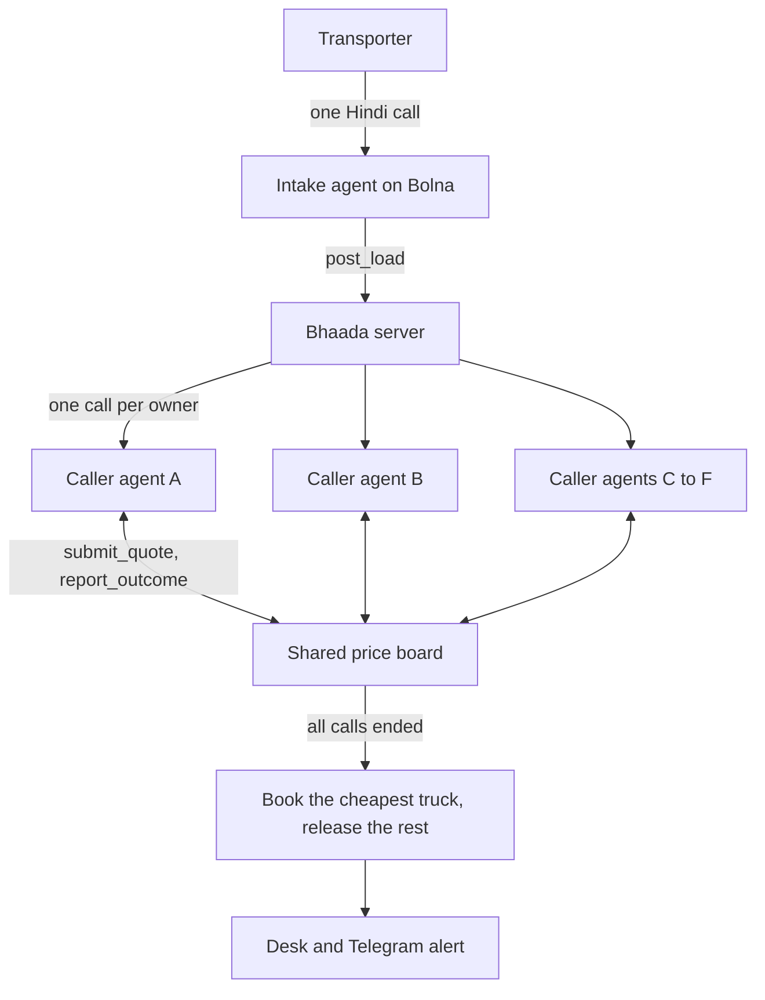

# Bhaada

**A Hindi voice agent that books trucks for Indian transporters.** A transporter makes one call and says the load. Bhaada phones their truck owners at the same time, bargains with each one in Hindi, collects the vehicle and driver details, and books the cheapest truck that agreed.

*Bhaada* (भाड़ा) means freight charge. Built on [Bolna](https://www.bolna.ai/) for the Bolna x Symphony Buildathon 2026.

| | |
|---|---|
| **Live site** | https://bhaada.vercel.app |
| **Booking desk** | https://bhaada.vercel.app/desk |
| **API server** | https://bolna-ai.onrender.com (Vercel forwards `/api/*` here) |
| **Project status and handoff** | [HANDOFF.md](HANDOFF.md): what is deployed, what has been tested, and what is left |
| **Problem research** | [research.md](research.md) |

The site runs on Render's free tier and sleeps when idle. The first request can take about a minute, so open it before a demo.

## The problem

When a transport agent gets a load, they spend the next hour phoning truck owners one at a time to ask who is free and haggle over the rate. Most owners run small fleets and do business by phone, so an app or load board doesn't reach them. The rate a transporter pays depends on how many owners they had time to call. [research.md](research.md) has the market evidence and its gaps.

## How it works



1. **Intake.** The transporter says the pickup, drop, time, truck, weight and maximum rate. The agent reads it back and posts the load only after they confirm.
2. **Parallel calls.** One caller agent starts per owner.
3. **Negotiation.** Each time an owner names a price, the agent asks the server what to do. The voice model never decides a price.
4. **Shared board.** When one owner agrees, every other agent must beat that rate, and can truthfully tell its owner that a truck is available at that price.
5. **Details.** The agent collects the vehicle and driver numbers piece by piece, and the server validates them.
6. **Booking.** Once every call has ended, the cheapest agreed truck is booked and any other agreed trucks are released.

### Pricing rules

The rules are in server code, so no conversation can talk an agent past the transporter's budget.

- The agent opens at the target rate, then meets the owner halfway in ₹500 steps, for at most three counters.
- It never goes above the ceiling. When a transporter phones in without naming an opening rate, the target is about 8% under their maximum.
- A rate another agent has locked lowers the ceiling to ₹500 below that rate. This is the only competing price an agent may mention.
- "Final" counts only after Bhaada has made an offer, so an opening "final" still gets one counter.
- An amount below a quarter or above four times the ceiling counts as a mishearing, and the agent asks again. This is why a dropped "हज़ार" can't book a truck for ₹38.
- `report_outcome` can only book a rate the rules accepted or offered.
- Vehicle and driver numbers get two retries. After that, the booking goes through flagged for a person to confirm.

## Two ways to run a load

| Mode | What happens | Cost |
|---|---|---|
| **Simulated** | Scripted owners bargain on the same board, with no phones involved | Free |
| **Live** | Owners with a phone number get real Bolna calls, and the rest are simulated on the same board | Bolna credits |

The Bolna trial allows two concurrent calls to verified numbers. A live demo of six agents is therefore up to two real calls plus simulated owners.

## Tech stack

| Layer | Technology |
|---|---|
| Web app and API | Next.js 16 (App Router, route handlers), React 19, TypeScript |
| Styling and motion | CSS Modules, GSAP, Lenis |
| Voice platform | Bolna: agents, call handling, Web Call SDK (`@bolna/web-call`) |
| Agent LLM | OpenAI `gpt-5.4-mini`, through Bolna |
| Speech to text | Sarvam `saaras:v4`, Hindi |
| Text to speech | Sarvam `bulbul:v3`, voice Suhani |
| Telephony | Plivo, through Bolna |
| Optional voice | Chatterbox Multilingual (FastAPI on a GPU), through Bolna Custom TTS; currently not in use |
| Alerts | Telegram Bot API; currently not configured |
| Hosting | Render web service, free tier, Node 24 |
| Data | In-memory store, in a single process |
| Tests | Node's built-in test runner |

## Repository layout

```
├── HANDOFF.md              Project status: deployed, tested, left to do
├── research.md             Problem research and the reasoning behind the idea
├── agent/bhaada-agent.md   Bolna agent setup guide
├── tts/                    Optional Chatterbox voice server
└── web/                    The Next.js app (Render's root directory)
    ├── scripts/
    │   ├── agents.mjs      Both agents' prompts and tool definitions
    │   └── bolna-setup.mjs Creates or updates the agents on Bolna
    ├── src/app/            Landing page, /desk and the API routes
    ├── src/components/     Desk and landing page UI
    ├── src/lib/            Price rules, board, loads, simulator, Bolna client
    └── tests/              Offline tests; these never place calls
```

[web/README.md](web/README.md) maps each file to what it does.

## Run it locally

Requires Node 24, which is what Render and the test runner use.

```bash
cd web
npm install
npm run dev        # http://localhost:3000
npm test           # offline, no calls placed
npm run lint
npx tsc --noEmit
npm run build
```

No keys are needed for the landing page or simulated loads. Open `/desk` and start a load in simulated mode.

For real calls, copy `web/.env.local.example` to `web/.env.local` and follow [agent/bhaada-agent.md](agent/bhaada-agent.md).

## Environment variables

| Variable | Used by | Purpose |
|---|---|---|
| `BOLNA_API_KEY` | Server, setup script | Bolna account key |
| `BOLNA_AGENT_ID` | Server, setup script | Caller agent id |
| `BOLNA_INTAKE_AGENT_ID` | Server, setup script | Intake agent id |
| `BHAADA_TOOL_TOKEN` | Server, setup script | Shared secret on Bolna's tool calls. It must match on both sides |
| `BHAADA_OWNER_PHONES` | Server | Real owners, as `phone` or `Name:phone`, comma-separated. Filled in order over the demo owners |
| `PUBLIC_URL` | Setup script only | The https address Bolna should call |
| `BHAADA_TTS_VOICE` | Setup script only | Custom TTS voice name. Empty uses Sarvam |
| `TELEGRAM_BOT_TOKEN`, `TELEGRAM_CHAT_ID` | Server | Booking alerts (optional) |

`.env*` files are ignored by Git. This repository is public, so never commit keys or real phone numbers.

## API

| Route | Called by | Auth | Purpose |
|---|---|---|---|
| `POST /api/loads` | Desk | None | Post a load and start its agents |
| `GET /api/loads?session=` | Desk | None | Find a load that was phoned in |
| `GET /api/loads/:id` | Desk | None | Poll a load, which also advances simulated calls |
| `GET /api/config` | Desk | None | Report whether live calls and phone-in are available |
| `GET /api/health` | Desk | None | Check both agents exist and Bolna reaches this server |
| `POST /api/bolna/session` | Desk | None | Start a browser call to the intake agent |
| `POST /api/bolna/intake` | Bolna, `post_load` | Tool token | Create a load from a phone-in and **dial the real owners** |
| `POST /api/bolna/draft` | Bolna, `save_details` | Tool token | Save what the transporter has said so far |
| `GET /api/bolna/draft?session=` | Desk | None | Fill the form during a phone-in |
| `POST /api/bolna/quote` | Bolna, `submit_quote` | Tool token | Return accept, counter, decline or ask again |
| `POST /api/bolna/outcome` | Bolna, `report_outcome` | Tool token | Validate and record how a call ended |
| `POST /api/bolna/webhook` | Bolna | None | Receive call status and transcripts |

The routes with no auth are a known gap. See [HANDOFF.md](HANDOFF.md#1-before-sharing-the-link-widely).

## Status

The core flow has worked on a real phone call: a real owner bargained, gave vehicle and driver numbers, and won the load against simulated owners in 110 seconds. Phone-in by voice on the deployed site, check calls and return loads are not done yet. [HANDOFF.md](HANDOFF.md) has the full list.
